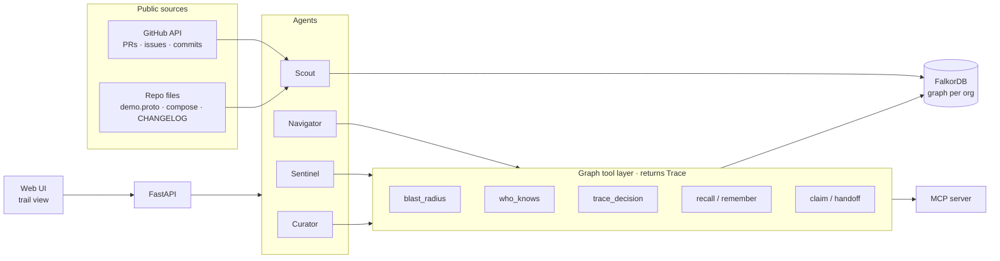

# Cairn

**Your engineering org's memory, as a graph that agents can follow.**

Ask what breaks, who actually knows, and why a decision was made. Every answer comes with the trail behind it.

> **Status:** pre-hackathon. This repo holds only design notes, the graph model sketch and empty scaffolding.
> All FalkorDB and agent code gets written during the [FalkorDB Hackathon](https://www.wemakedevs.org/hackathons/falkordb)
> (Oct 15–18, 2026 IST), per rule 8.

**Tracks entered:** Track 01 (Agents That Act on Connected Data) · Track 02 (Agent Memory and Coordination) · Track 03 (Company Brain)

---

## The problem

A service starts failing at 2 a.m. The on-call engineer needs three answers fast:

1. **What breaks?** Which services call this one, directly or several hops away?
2. **Who knows it?** CODEOWNERS says `@org/approvers` for everything. Who has actually changed this code in the last six months?
3. **Why is it built this way?** The decision behind the setup sits in a PR thread from two years ago.

Each answer lives somewhere different: compose files and protobuf contracts, git history, PR and issue threads. Agents that work from chunked text see fragments. They forget what they learned yesterday, and they can't show their reasoning.

## What Cairn does

Cairn reads a software organisation's **public** engineering record (service contracts, deployment files, commits, PRs, issues, changelogs) and writes it into **FalkorDB** as a time-aware graph. A small team of agents then works from that graph:

| Agent | Job | Graph work |
|---|---|---|
| **Scout** | Ingests sources and extracts entities, facts and decisions | Episodes for provenance, entity resolution, two-timeline fact edges, contradiction retirement |
| **Navigator** | Answers questions about the company: who knows what, why a decision was made | Multi-hop traversal, vector and full-text index lookups, decision chains |
| **Sentinel** | Investigates incidents and risky changes, then acts | `algo.bfs` blast radius, `algo.SPpaths`, `algo.betweenness` choke points, routing to owners, gated actions |
| **Curator** | Keeps memory accurate over time | Confidence decay, stale-owner detection, playbook consolidation, `algo.WCC` and `algo.labelPropagation` silo checks |

Cairn leaves a marker for every answer. The answer is saved as a node, linked to the exact nodes, edges and source episodes it relied on, and drawn in the UI as a highlighted path. Ask again next week, or ask from a different agent, and the earlier investigation is still there to build on.

## Why a graph, and why FalkorDB

The questions are about connections, so the graph is the product, not a side store:

- **Blast radius** means walking `CALLS` edges up to N hops.
- **Who knows X** is a time-weighted walk from `Person` through `PullRequest` and `File` to `Service`.
- **Why did we decide Y** follows `Decision → SUPERSEDES → Decision → EVIDENCED_BY → Episode`.
- **Bus factor and knowledge silos** come from betweenness and connected components on the people–system graph.
- **Agent coordination** runs on `Task`, `Claim` and `Handoff` nodes that every agent reads and writes.

FalkorDB features in use:

- one isolated graph per organisation (multi-tenant);
- built-in algorithms (`algo.bfs`, `algo.SPpaths`, `algo.betweenness`, `algo.pageRank`, `algo.WCC`, `algo.labelPropagation`);
- vector index (HNSW, cosine) on chunks, facts and playbooks;
- full-text index on titles and names;
- range indexes on IDs and time fields.

## Architecture



Every graph tool returns a **Trace**: the Cypher it ran, the nodes and edges it touched, and the source episode behind each edge. Agents pass traces along, answers cite them, and the UI draws them.

## Graph data model (draft)

**Knowledge layer:**

```
(:Person {login, name})        -[:MEMBER_OF]->     (:Team)
(:Person)                      -[:AUTHORED {at}]-> (:PullRequest)
(:Person)                      -[:REVIEWED {at}]-> (:PullRequest)
(:PullRequest)                 -[:TOUCHES]->       (:File) -[:PART_OF]-> (:Service {name, language})
(:PullRequest)                 -[:RESOLVES]->      (:Issue)
(:Service)                     -[:CALLS {rpc, protocol}]-> (:Service)
(:Service)                     -[:USES]->          (:Datastore)
(:Decision {title, status})    -[:AFFECTS]->       (:Service)
(:Decision)                    -[:SUPERSEDES]->    (:Decision)
(:Person)                      -[:DECIDED]->       (:Decision)
(:Doc|:Issue|:PullRequest)     -[:HAS_CHUNK]->     (:Chunk {text, embedding})
(any fact edge)                .source_episode  →  (:Episode {kind, url, observed_at})
```

Fact edges carry **two timelines**:

- `valid_from` / `valid_to`: when the fact was true in the world.
- `recorded_at` / `retired_at` / `retired_by`: when Cairn learned it and why it stopped believing it.

Nothing is deleted. A superseded fact is retired, and the record says which episode retired it.

**Memory and coordination layer:**

```
(:Agent {name, role})  -[:RAN]->       (:Task {status, lease_until, claimed_by})
(:Task)                -[:HANDED_OFF_TO {reason}]-> (:Agent)
(:Session {user})      -[:ASKED]->     (:Answer {question, text})
(:Answer)              -[:CITES]->     (node or path elements)
(:Answer)              -[:USED]->      (:Playbook {intent, steps, wins, losses, intent_embedding})
(:Finding)             -[:ABOUT]->     (:Service|:Person|:Decision)
```

- **Episodic** memory is sessions, tasks and answers.
- **Semantic** memory is the knowledge layer.
- **Procedural** memory is playbooks: tool sequences that answered a kind of question, reinforced by feedback.

## Key Cypher (sketches, verified and finalised during the event)

```cypher
// Blast radius: who calls this service, up to 4 hops, with paths for the trail
MATCH p = (caller:Service)-[:CALLS*1..4]->(s:Service {name: $service})
RETURN p
```

```cypher
// Who actually knows a service: recent, time-decayed authorship and review
MATCH (p:Person)-[a:AUTHORED|REVIEWED]->(:PullRequest)-[:TOUCHES]->(:File)-[:PART_OF]->(s:Service {name: $service})
WITH p, sum(CASE type(a) WHEN 'AUTHORED' THEN 1.0 ELSE 0.5 END
            * exp(-($now - a.at) / $half_life)) AS score
RETURN p.login AS person, score ORDER BY score DESC LIMIT 5
```

```cypher
// Bus factor: people who hold the knowledge graph together
CALL algo.betweenness({nodeLabels: ['Person', 'Service'], relationshipTypes: ['KNOWS']})
YIELD node, score
RETURN node.login AS person, score ORDER BY score DESC LIMIT 10
```

```cypher
// Decision trace: why is a service built this way, and what did it replace
MATCH (d:Decision)-[:AFFECTS]->(:Service {name: $service})
OPTIONAL MATCH chain = (d)-[:SUPERSEDES*1..5]->(:Decision)
OPTIONAL MATCH (d)-[:EVIDENCED_BY]->(e:Episode)
RETURN d, chain, collect(e.url) AS sources
```

```cypher
// Coordination: claim a task atomically (writes to a graph are serialised)
MATCH (t:Task {id: $id})
WHERE t.status = 'open' OR t.lease_until < $now
SET t.status = 'claimed', t.claimed_by = $agent, t.lease_until = $now + $ttl
RETURN t
```

```cypher
// Semantic recall over chunks
CALL db.idx.vector.queryNodes('Chunk', 'embedding', 8, vecf32($query_vector)) YIELD node, score
MATCH (src)-[:HAS_CHUNK]->(node)
RETURN src, node.text, score
```

## Demo dataset

The demo uses [open-telemetry/opentelemetry-demo](https://github.com/open-telemetry/opentelemetry-demo) (Apache-2.0, fully public). It has about 25 services in more than 10 languages, a gRPC contract (`pb/demo.proto`), compose deployments, over 3,000 PRs, over 600 issues and over 100 contributors. A second organisation, [GoogleCloudPlatform/microservices-demo](https://github.com/GoogleCloudPlatform/microservices-demo), runs as a separate tenant graph to show isolation.

No private, login-protected or personal data is loaded (rule 6). People are identified only by public GitHub handles.

## Stack

- **Graph:** FalkorDB (Docker), FalkorDB Browser for inspection.
- **Backend:** Python 3.12, FastAPI, the `falkordb` client, `mcp` (FastMCP).
- **Models:** Claude via the Anthropic SDK: `claude-opus-5-5` for the reasoning agents and `claude-haiku-5-5` for bulk extraction.
- **Embeddings:** local `fastembed` (bge-small, 384 dimensions), so there is no extra API.
- **Web:** Vite, React, TypeScript, with the graph trail drawn by sigma.js.

## Running locally

```bash
cp .env.example .env            # add ANTHROPIC_API_KEY and GITHUB_TOKEN
docker compose up -d falkordb   # FalkorDB on :6379, Browser on :3000
cd server && uv sync            # Python deps
cd ../web && npm install        # web deps
```

Ingestion, API and UI commands get added here as they're built.

## Prior art we studied

We read these projects to learn from their designs. Every line of Cairn is our own implementation.

- **[Graphiti](https://github.com/getzep/graphiti)** (Apache-2.0): episodes as provenance, edges with two timelines, layered entity resolution.
  - Cairn adds deterministic reasons for retiring facts, and uses FalkorDB's native vector index and algorithms where Graphiti does brute-force cosine and Python label propagation.
- **[Cognee](https://github.com/topoteretes/cognee)** (Apache-2.0): supersession for single-valued relations, and memory passes that run after ingestion.
- **[FalkorDB code-graph](https://github.com/FalkorDB/code-graph)** (MIT) and **[CodeGraphContext](https://github.com/CodeGraphContext/CodeGraphContext)** (MIT): code graphs as agent tools.
  - Neither connects code to the people who own it or the decisions behind it.
- **[neo4j-contrib/gds-agent](https://github.com/neo4j-contrib/gds-agent)** (MIT): graph algorithms exposed as typed MCP tools, for Neo4j only.
- **[Cartography](https://github.com/cartography-cncf/cartography)** (Apache-2.0): pairing every finding query with a query that returns the path explaining it.

## AI assistance disclosure

We use AI coding assistants (Claude Code) for research, scaffolding and pair programming, as required by rule 11. We can explain and defend the graph model, the queries, the architecture and every technical decision.

## License

Apache-2.0
