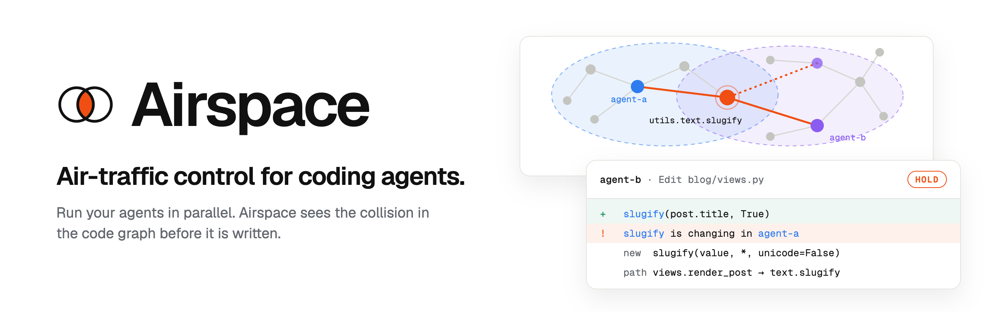
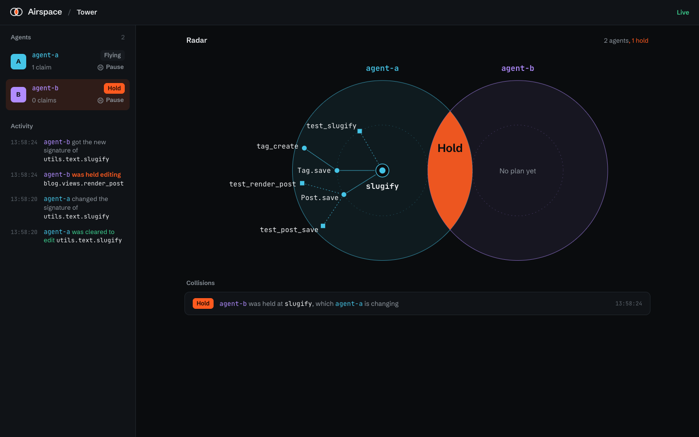
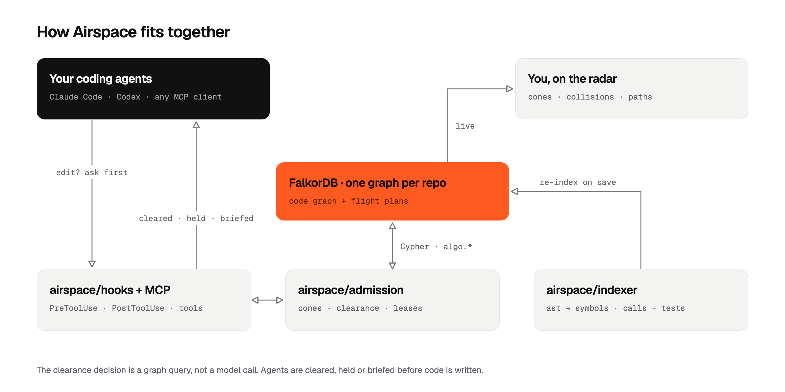
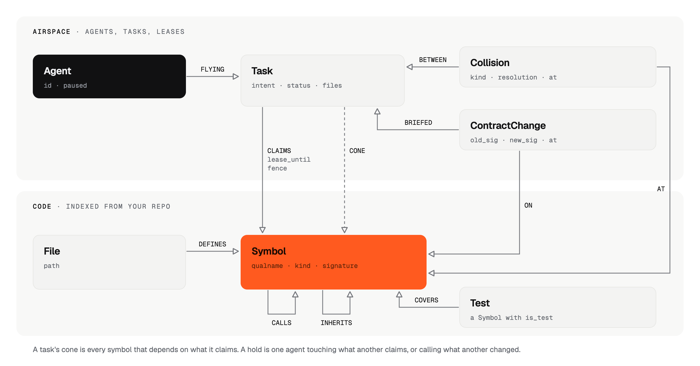

<p align="center">
  <picture>
    <source media="(prefers-color-scheme: dark)" srcset="assets/readme/banner-dark.png">
    
  </picture>
</p>

<p align="center">
  
  
  
  
  <a href="LICENSE"></a>
</p>

<p align="center"><b><a href="https://airspace.sushans.dev">airspace.sushans.dev</a></b> · <a href="https://airspace.sushans.dev/tower">Tower</a> · <a href="https://airspace.sushans.dev/preflight">Pre-flight</a> · <a href="https://airspace.sushans.dev/playground">Playground</a></p>

<!-- hero.gif: four agents, one collision on the radar, a held edit, a briefing, a green merge. Recorded on Oct 18. -->

**Airspace is air-traffic control for parallel coding agents.** Split a feature across four Claude Code sessions and each one passes its tests on its own. Merge them, and `main` is red: one agent changed a function that another was busy calling. Airspace keeps a live graph of how your code connects. It checks every edit against that graph before the edit is written, and holds the one that would collide.

**The graph decides; Airspace acts.** Every decision is a FalkorDB query, never a model call, and every decision is enforced:

- **Before agents start,** pre-flight plans the work: which tasks can run in parallel and which must coordinate, with the path between them.
- **Before every edit,** clearance holds the one that would break another agent's work, and tells the agent the new contract.
- **Before an agent finishes,** the landing check sends it back if a call it wrote no longer fits.
- **Across sessions,** what agents learn stays on the graph, attached to the code it is about, and reaches the next agent that touches that code.

On the real Flask repo, with real Claude Code agents: **9 of 9** parallel pairs merged green with Airspace, **0 of 9** without it.

Built for two kinds of people:

- **Developers** who run several agents at once and are tired of clean merges that break the build.
- **Tool builders** who orchestrate fleets of agents and need a shared, queryable picture of who is touching what.

## How it works

1. **Claim what you touch.** When an agent edits a symbol, its task claims it under a lease. Its **impact cone** is everything that calls, overrides or tests what it claims, two hops out. An agent can also file a flight plan up front through the MCP server.
2. **Ask before every write.** A Claude Code `PreToolUse` hook checks each `Edit`, `Write` and `MultiEdit` with Airspace before the file changes. The answer is a graph query and a few rules, never a model call:
   - **hold** when the edit touches a symbol another agent has claimed, or adds a call that no longer fits a contract another agent changed;
   - **cleared** otherwise. Python's own argument-binding rules decide whether a call fits a signature.
3. **Brief, don't surprise.** When one agent changes a signature, every agent whose code depends on it gets a briefing on its next tool call: the old and new signature and, when known, the call it breaks.
4. **Hold at landing.** When an agent stops, Airspace checks the calls in every file it edited against every contract change by another agent. While another agent is still working on something it calls, it waits; if a call no longer fits, it is sent back once with the change.

The edit tool returned this to agent-b in a real run, when it wrote `slugify(post.title, allow_unicode=True)` on its own branch after agent-a changed `slugify`:

```text
Airspace hold: utils.text.slugify is being changed by agent-a. New signature: slugify(value, *, unicode=False)
(was slugify(value, allow_unicode=False)). This edit adds a call to it from blog.views.render_post. The call
blog.views.render_post makes does not fit the new signature. Path: blog.views.render_post -> utils.text.slugify.
A retry whose call matches the new signature will be cleared. That change is not in this working copy yet, so
local tests still reflect the old signature until the branches are merged. A call that fits the new signature
is the one that merges cleanly, and a local test failure caused only by that difference goes away at the merge.
```

agent-b retried with `slugify(post.title, unicode=True)` and was cleared. The collision resolved, both agents landed, and the merged branches passed every test.

### Tower: watch and steer from the browser

Your agents work in their own Claude Code terminals. **Tower** is the web app where you see all of them at once and step in when you need to. Everything it shows is read live from the graph, and everything you do there is enforced on the agent's next tool call.



| You see | You can do |
| --- | --- |
| **Radar:** each agent's airspace with the symbols it claims and their callers; the overlap turns orange on a hold | **Release** a hold the agent should not wait for |
| **Activity:** every clearance, hold, briefing, contract change and landing, as it happens | **Pause** or resume an agent; its edits are held until you resume it |
| **Collision:** the held agent, the changing agent, the symbol, and the path between them | **Message** an agent; the note arrives with its next tool call |
| **Replay:** a recorded run of two real Claude Code sessions, when no agent is flying | |

Hot zones, the symbols where agents collide most across sessions, come from `airspace insights` and the `hot_zones` MCP tool.

### Pre-flight: plan parallel work before any agent starts

Write the tasks you are about to hand out and the symbols each will change. Pre-flight answers from the graph, before anyone edits anything: which tasks can run in parallel, which must coordinate, and the path between them. On Flask, five tasks give three groups:

```text
$ airspace preflight --root flask \
    --task "Routing: Scaffold.route" --task "Rule registration: Scaffold.add_url_rule" \
    --task "Error handlers: Flask.handle_user_exception" --task "Error lookup: App._find_error_handler" \
    --task "Debug flag: get_debug_flag"

Three groups. Routing and Rule registration must coordinate; Error handlers and Error lookup must coordinate;
Debug flag can run in parallel.
```

Each task's impact cone is a Cypher traversal over `CALLS|COVERS|INHERITS`; the explanation is `shortestPath`; the groups are `algo.WCC` over the pairs that meet; hot spots are `algo.betweenness`. Try it on Flask at [airspace.sushans.dev/preflight](https://airspace.sushans.dev/preflight), from the CLI, or from an orchestrator through the `preflight` MCP tool.

### Why a graph

| | |
| --- | --- |
| **Collisions are paths** | Whether an edit reaches another agent's work is a traversal over `CALLS`, `INHERITS` and `COVERS`, not a text match. Each `CALLS` edge carries the shapes of its call sites, so a changed signature is checked against every real caller. |
| **Every hold explains itself** | A hold names the caller, the changed symbol and the path between them. `explain` finds the shortest path between any two symbols with `shortestPath`. |
| **Parallel by default** | Agents only wait when their work actually meets. `algo.WCC` over the conflict graph groups the agents that do, shown by `airspace insights`. |
| **It remembers** | Holds, briefings and contract changes stay in the graph. Hot zones, ranked by collisions and `algo.betweenness`, come from `airspace insights` and the `hot_zones` MCP tool. |

<p align="center">
  <picture>
    <source media="(prefers-color-scheme: dark)" srcset="assets/readme/architecture-dark.png">
    
  </picture>
</p>

## The graph

Each repo gets its own graph in FalkorDB. It has two layers: the code, and the agents working on it.

<p align="center">
  <picture>
    <source media="(prefers-color-scheme: dark)" srcset="assets/readme/graph-model-dark.png">
    
  </picture>
</p>

<details>
<summary>The same model as text</summary>

```text
(:File {path})-[:DEFINES]->(:Symbol {qualname, kind, signature, sig_hash, is_test})
(:Symbol)-[:CALLS {shapes}]->(:Symbol)
(:Symbol)-[:COVERS {shapes}]->(:Symbol)        // from a test
(:Symbol)-[:INHERITS]->(:Symbol)

(:Agent {id, paused})-[:FLYING]->(:Task {intent, status, touched, files})
(:Task)-[:CLAIMS {lease_until, fence}]->(:Symbol)
(:Task)-[:CONE]->(:Symbol)
(:Task)-[:READING {at}]->(:File)
(:Task)-[:CHANGED]->(:ContractChange {qualname, old_sig, new_sig, at})-[:ON]->(:Symbol)
(:ContractChange)-[:BRIEFED]->(:Task)
(:Collision {kind, resolution, at})-[:BETWEEN]->(:Task)
(:Collision)-[:AT]->(:Symbol)
(:Message {text, sender, at})-[:TO]->(:Agent)
```

</details>

Some of the queries the product runs on every edit:

```cypher
// Impact cone: everything that depends on what a task holds a live claim on, up to 2 hops
MATCH (t:Task {id: $task})-[c:CLAIMS]->(s:Symbol) WHERE c.lease_until > $now
MATCH (d:Symbol)-[:CALLS|COVERS|INHERITS*1..2]->(s)
MERGE (t)-[:CONE]->(d)
```

```cypher
// Clearance: does this edit touch a symbol another agent's active task holds under a live lease?
MATCH (a:Agent)-[:FLYING]->(o:Task {status: 'active'})-[c:CLAIMS]->(:Symbol {qualname: $q})
WHERE a.id <> $agent AND c.lease_until > $now
RETURN o.id, a.id LIMIT 1
```

```cypher
// Clearance: is this new call into a contract another agent has changed?
MATCH (a:Agent)-[:FLYING]->(o:Task)-[:CHANGED]->(cc:ContractChange {qualname: $callee})
WHERE a.id <> $agent AND o.status IN $standing
RETURN cc.old_sig, cc.new_sig, a.id
```

```cypher
// Why: the shortest path between my work and theirs (shortestPath must sit in WITH or RETURN in FalkorDB)
MATCH (a:Symbol {qualname: $a}), (b:Symbol {qualname: $b})
WITH shortestPath((a)-[:CALLS|COVERS|INHERITS*..6]->(b)) AS p
RETURN [n IN nodes(p) | n.qualname]
```

```cypher
// Lease a symbol atomically (writes to one graph are serialised).
// Every node is matched before the aggregation: in FalkorDB a MATCH after WITH ... count() loses rows.
MATCH (t:Task {id: $task}), (s:Symbol {qualname: $q})
OPTIONAL MATCH (o:Task)-[c:CLAIMS]->(s) WHERE o.id <> $task AND c.lease_until > $now
WITH t, s, count(c) AS held
WHERE held = 0
MERGE (t)-[k:CLAIMS]->(s)
SET k.lease_until = $now + $ttl, k.fence = coalesce(k.fence, 0) + 1
RETURN k.fence
```

## Does it work?

### On Flask

Real code, real agents: [Flask](https://github.com/pallets/flask) at a pinned commit (83 Python files, 894 symbols), graded with Flask's own 491 tests plus a hidden test for each agent. Agent A changes part of Flask's public API while agent B, on its own branch, adds a feature that uses it.

| Condition | Merged build green | Median time per pair | Cost per pair |
| --- | --- | --- | --- |
| Worktrees only | **0 of 9** | 35 s | $0.36 |
| Broadcast | **5 of 9** | 40 s | $0.37 |
| Airspace | **9 of 9** | 41 s | $0.41 |

| What agent A changes while agent B calls it | Worktrees | Broadcast | Airspace |
| --- | --- | --- | --- |
| `get_flashed_messages` renames `category_filter` to `categories` | 0 / 3 | 3 / 3 | 3 / 3 |
| `get_debug_flag` is renamed to `get_debug_env` | 0 / 3 | 0 / 3 | 3 / 3 |
| `send_file` renames `download_name` to `filename` | 0 / 3 | 2 / 3 | 3 / 3 |

Every run is in [`server/bench/results/flask`](server/bench/results/flask). The first Flask run ([`flask-v1`](server/bench/results/flask-v1), 7 of 9) found a real bug: with agents on separate worktrees sharing one graph, re-indexing a file from a worktree that never had the other agent's change read as a change back to the old signature. A re-index now only counts changes to symbols the agent's own edits touched, and the graph keeps the newest contract.

**On a real repo, the graph holds up.**

| | Flask |
| --- | --- |
| Index the whole repo | 0.44 s |
| Calls resolved to a symbol in the repo | 845 (up from 194 before src layouts, package re-exports, base classes and local instances were handled) |
| Test coverage edges | 434 |
| Hook latency, as Claude Code runs it (a new process per edit) | 193 ms median before an edit, 181 ms after |
| Pre-flight plan for five tasks | about 20 ms |

What stays unresolved is mostly calls into the standard library, third-party packages and builtins, which are not part of the repo, and calls on pytest fixtures, whose type Airspace does not guess.

### On a sample repo, six kinds of change

Two real Claude Code agents work at the same time on one small repo. Agent A changes a contract (a keyword argument, a parameter, a method name, a constructor, a return value) while agent B writes new code that calls it. Each pair runs under three conditions, three times each, graded after [*Passes Alone, Fails Together*](https://arxiv.org/abs/2609.25396): both agents' hidden tests run on the merge of their branches.

| Condition | Merged build green | Median time per pair | Cost per pair |
| --- | --- | --- | --- |
| Worktrees only (each agent on its own branch) | **0 of 18** | 25 s | $0.27 |
| Broadcast (each agent is also told the other's task) | **3 of 18** | 28 s | $0.27 |
| Airspace | **17 of 18** | 43 s | $0.31 |

| What agent A changes while agent B calls it | Worktrees | Broadcast | Airspace |
| --- | --- | --- | --- |
| A keyword argument is renamed (`slugify`) | 0 / 3 | 0 / 3 | 3 / 3 |
| A parameter becomes keyword-only (`truncate_words`) | 0 / 3 | 0 / 3 | 3 / 3 |
| A method is renamed (`Post.get_absolute_url`) | 0 / 3 | 0 / 3 | 3 / 3 |
| A required parameter is added (`render_post`) | 0 / 3 | 0 / 3 | 3 / 3 |
| A constructor gains an argument (`Post.__init__`) | 0 / 3 | 0 / 3 | 2 / 3 |
| A method stops returning a value (`Tag.save`) | 0 / 3 | 3 / 3 | 3 / 3 |

Every run is in [`server/bench/results/final`](server/bench/results/final): both diffs, the test output and the cost. Run it yourself with `uv run python -m airspace.bench.runner --repeat 3`.

**What the numbers mean.**
- Under Airspace, agent B is held at the edit that would break, reads agent A's new contract in the hold, and writes against it. B's patch then fails on its own old branch and passes merged. The paper's alone-then-merged grading calls that a failed task; the merged build is what a team ships, so it is the headline.
- Airspace is slower per pair because a held agent waits for the change it depends on.
- The one miss: agent B was held, understood the hold, and stopped to ask whether to write code that fails its local tests until the merge. The hold note now says that such a failure goes away at the merge.

**Honest limits.** The paper found interference in 97% of runs on constructed Django tasks, but in only 1 of 417 pairs of real merged PRs. Constructed tasks show whether a coordination method works; they don't show how often the problem happens in practice. Airspace's code graph is built from Python `ast`, so dynamic dispatch and string imports can hide edges, and unresolved calls are reported, not guessed. A change in behaviour that keeps the signature and the return shape (a different value of the same type) is not caught.

## What's in this repo

| Path | What it is |
| --- | --- |
| [`server/src/airspace/indexer`](server/src/airspace/indexer) | Python `ast` to symbols, calls with their argument shapes, inheritance and test coverage, re-indexed per file |
| [`server/src/airspace/graph`](server/src/airspace/graph) | FalkorDB connection, schema, indexes and the Cypher above |
| [`server/src/airspace/admission`](server/src/airspace/admission) | Claims, cones, clearance, call-shape checks, briefings, the landing check, insights |
| [`server/src/airspace/hooks`](server/src/airspace/hooks) | Claude Code hooks: clearance before an edit, reindex after it, git reconcile after shell commands, briefings on every tool call, the holding pattern at `Stop` |
| [`server/src/airspace/mcp_server`](server/src/airspace/mcp_server) | MCP tools: `file_flight_plan`, `check_symbols`, `briefings`, `explain`, `hot_zones`, `preflight` |
| [`server/src/airspace/api`](server/src/airspace/api) | HTTP, server-sent events, Tower actions, replay and the playground |
| [`server/src/airspace/cloud`](server/src/airspace/cloud) | GitHub sign-in, workspaces (one graph each), keys, and the RPC endpoint connected hooks call |
| [`server/src/airspace/remote.py`](server/src/airspace/remote.py) | The client side: `airspace connect`, and hooks that send engine calls to the hosted server |
| [`server/src/airspace/bench`](server/src/airspace/bench) | The three-condition benchmark harness, on the sample repo or Flask (`--suite flask`) |
| [`web`](web) | The site and Tower: live radar, activity, collisions, pause, message and release, replay, playground (Vite, React) |
| [`docs/notes.md`](docs/notes.md) | Research, plan and decisions |

## Try it

| Time | How | You need |
| --- | --- | --- |
| 30 s | Open [**Tower**](https://airspace.sushans.dev/tower) and replay a recorded run of two real Claude Code sessions. Click a collision for its path. | A browser |
| 2 min | [**Playground**](https://airspace.sushans.dev/playground): pick what two agents will change in a sample repo and get the verdict and the path. No agents and no API key, because clearance is a graph query, not a model call. | A browser |
| 5 min | Sign in, create a workspace, `airspace connect` your repo, open two Claude Code sessions ([hosted Tower](#or-use-the-hosted-tower)) | Claude Code |
| 15 min | Index any Python repo locally, install the hooks, open two Claude Code sessions ([Quick start](#quick-start)) | Docker, Claude Code |

## Quick start

```sh
docker compose up -d falkordb                      # FalkorDB on :6379, Browser on :3000
cd server && uv sync

uv run airspace index --root /path/to/your/repo          # build the code graph
uv run airspace install-hooks --root /path/to/your/repo  # Claude Code hooks: PreToolUse, PostToolUse, Stop, UserPromptSubmit
uv run airspace status --root /path/to/your/repo         # agents, claims and recent collisions
```

Open two Claude Code sessions in that repo (set `AIRSPACE_AGENT=agent-a` and `agent-b` to name them) and let them work on the same feature. Every `Edit`, `Write` and `MultiEdit` on a Python file is checked first. Files written by shell commands are reconciled with git after each command. When a session stops, it waits while another agent is still working on something it calls (up to four minutes), and is sent back once if its calls do not fit the new signatures.

### Or use the hosted Tower

No FalkorDB on your machine: sign in at [airspace.sushans.dev](https://airspace.sushans.dev/app) with GitHub, create a workspace for the repo, and connect it with the key it shows you once:

```sh
cd server && uv sync
uv run airspace connect --root /path/to/your/repo --server https://airspace.sushans.dev --key ask_...
uv run airspace install-hooks --root /path/to/your/repo
```

Your sessions then show up live in that workspace's Tower. Parsing stays on your machine: the hooks send symbol names, signatures, call shapes and the one-line text of calls, never whole files. `airspace disconnect --root /path/to/your/repo` goes back to a local FalkorDB.

Run the tests (FalkorDB must be running):

```sh
cd server && uv run pytest -q
```

The website lives in `web/` (`npm install && npm run dev`).

## Open decisions

- [x] **Where the decision lives.** Clearance is Cypher plus rules, enforced by a hook. No model is asked whether an edit is safe. If FalkorDB is unreachable the hook fails open and says so, so Airspace never stops an agent by being down.
- [x] **First language.** Python, through the standard-library `ast`. Other languages come later through tree-sitter.
- [x] **First harness.** Claude Code, through `PreToolUse`, `PostToolUse`, `Stop` and `UserPromptSubmit` hooks. Any MCP client can use the same tools.
- [x] **Storage.** Everything (code graph, flight plans, leases, history) lives in FalkorDB, one graph per repo. No side database.
- [x] **Benchmark repo.** A small blog app with six constructed task pairs, so every pair runs in under a minute and the whole matrix can repeat.
- [x] **Cone depth.** Two hops by default (`AIRSPACE_CONE_DEPTH`). Contract changes reach every direct caller, whatever the depth.
- [x] **Writes outside the edit tools.** After every shell command and before landing, the working copy is reconciled with git, so `cat > file` or `sed -i` cannot skip the check.

## Roadmap

- [x] Indexer and code graph, with incremental re-index on save
- [x] Cones, clearance, leases and collision paths
- [x] Claude Code hooks and CLI
- [x] Briefings on contract changes, with call-shape checks and rename detection
- [x] Holding pattern at landing, read and prompt interest, git reconcile for shell writes
- [x] MCP server
- [x] Tower: radar, activity and collision views
- [x] Tower actions: release, pause, message
- [x] Tower playground and replay mode
- [x] Hot-zone memory across sessions
- [x] Benchmark: worktrees vs broadcast vs Airspace
- [x] A real repo: Flask indexed, benchmarked with real agents, and planned with pre-flight
- [x] Hosted workspaces with GitHub sign-in
- [x] Live deployment at [airspace.sushans.dev](https://airspace.sushans.dev)
- [ ] Demo video and write-up
- [ ] TypeScript and Go through tree-sitter
- [ ] Other harnesses through MCP: Codex, Cursor, Gemini CLI

## Prior art

- [*Passes Alone, Fails Together*](https://arxiv.org/abs/2609.25396) (Xia, Wu, Park, 2026): the benchmark method and the broadcast baseline.
- [*Claim Plane*](https://arxiv.org/abs/2607.21909) (Nikolaev, 2026): admitting change intents before any write.
  - Airspace works out scope from a live graph instead of asking agents to declare every resource.
- [FalkorDB code-graph](https://github.com/FalkorDB/code-graph) and [CodeGraphContext](https://github.com/CodeGraphContext/CodeGraphContext): code graphs as tools for a single agent.
  - We studied their schemas. Airspace's indexer is our own.

## FalkorDB Hackathon

Built for the [FalkorDB Hackathon](https://www.wemakedevs.org/hackathons/falkordb) (October 15 to 18, 2026).

**Track 01 · Agents That Act on Connected Data.** A graph makes the decision and Airspace takes the action:

- The decision is Cypher over a live code graph: impact cones, call shapes checked against changed signatures, `shortestPath` for the explanation, `algo.WCC` to group parallel work, `algo.betweenness` for hot spots.
- The action is enforced, not suggested: an edit is blocked before it is written, an agent is held at landing, the other agent is briefed, and Tower can pause, message or release.
- Measured on Flask: 9 of 9 merges green with Airspace, 5 of 9 when each agent is told the other's task, 0 of 9 with worktrees alone.

**Track 02 · Agent Memory and Coordination.** Agents remember across sessions and share what they know:

- One shared graph per repo holds who is changing what, every contract change, every collision and how it was resolved.
- Notes and fixes are attached to the symbols they are about, so the graph decides who hears them: the next agent that edits, calls, reads or is given a task about that code, in this session or a later one.

The organisers confirmed that building may start before the event; work began on October 14.

We use AI coding assistants (Claude Code) for research, scaffolding and pair programming, and say so here as rule 11 requires. We can explain every part of the graph model, the queries and the design.

## Creators

<table>
  <tr>
    <td align="center" width="160">
      <a href="https://github.com/sushanshetty1"><br><b>Sushan Shetty</b></a><br><sub>@sushanshetty1</sub>
    </td>
  </tr>
</table>

## License

[Apache-2.0](LICENSE).
